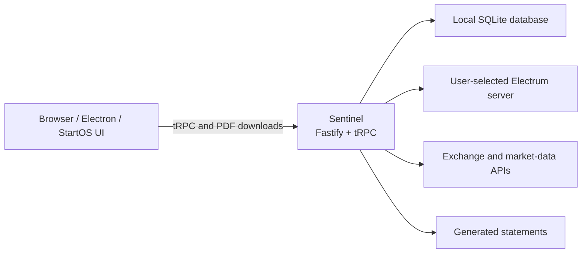

# Bitcoin Control Center

Bitcoin Control Center is a local-first Bitcoin portfolio tracker and proof-of-reserves statement generator. It connects directly to an Electrum server, stores portfolio data in a local SQLite database, and runs without a Hoseki cloud account or hosted application backend.

The same React application and Sentinel backend can run in a browser during development, as a StartOS service, or as an Electron desktop application for macOS and Windows.

> [!IMPORTANT]
> Bitcoin Control Center is watch-only portfolio software. Keep wallet seeds and private keys out of the application, logs, screenshots, bug reports, and test fixtures.

## Features

- Track self-custody Bitcoin accounts using descriptors and extended public keys.
- Connect supported hardware wallets, including Ledger, Trezor, Coldcard, and Keystone workflows.
- Track supported exchange accounts: Coinbase, Kraken, Robinhood, and Strike.
- Add manually maintained Bitcoin and ETF holdings.
- Record local balance history for portfolio charts.
- Prove control of self-custody accounts with signed-message challenges.
- Generate downloadable portfolio and proof-of-reserves statements.
- Store account data and encrypted exchange credentials locally.
- Package the same application for StartOS, macOS, and Windows.

This repository intentionally excludes Hoseki Services, Armadillo, hosted authentication, billing, sharing, telemetry, and cloud deployment code.

## Contents

- [Architecture](#architecture)
- [Prerequisites](#prerequisites)
- [Quick start](#quick-start)
- [Configure Sentinel](#configure-sentinel)
- [Run the application](#run-the-application)
- [Local data and backups](#local-data-and-backups)
- [Development commands](#development-commands)
- [Testing and CI](#testing-and-ci)
- [Production builds](#production-builds)
- [StartOS packaging](#startos-packaging)
- [StartOS release candidates](#startos-release-candidates)
- [Desktop packaging](#desktop-packaging)
- [Troubleshooting](#troubleshooting)
- [Security and privacy](#security-and-privacy)
- [Contributing](#contributing)
- [License](#license)

## Architecture



| Path                   | Purpose                                                        |
| ---------------------- | -------------------------------------------------------------- |
| `apps/control-center/` | React 19 and Vite frontend                                     |
| `apps/api-sentinel/`   | Fastify/tRPC backend, SQLite storage, and statement generation |
| `packages/`            | Shared Bitcoin, wallet, UI, parsing, and utility code          |
| `start9/`              | StartOS SDK integration and multi-architecture package build   |
| `desktop/`             | Electron shell and bundled Tor integration                     |
| `docs/`                | Developer, security-audit, migration, and test documentation   |
| `test/`                | Shared public test fixtures                                    |

Sentinel is the only application backend and owns the frontend API contract. Distribution-specific behavior belongs in `start9/` or `desktop/`; the product does not use a hosted compatibility API.

## Prerequisites

Local browser development requires:

- Git
- Node.js 22.23.2 or newer; `.nvmrc` selects Node 22.23.2
- Corepack and pnpm 10.17.0
- Access to an Electrum server whose network matches `BITCOIN_NETWORK`
- A Chromium-based browser for WebHID hardware-wallet workflows

Optional packaging requirements are listed under [StartOS packaging](#startos-packaging) and [Desktop packaging](#desktop-packaging).

If you use `nvm`, install and select the repository's Node version with:

```bash
nvm install
nvm use
```

Confirm the active tools before installing dependencies:

```bash
node --version
corepack enable
pnpm --version
```

The root `package.json` pins pnpm through its `packageManager` field, so Corepack should select pnpm 10.17.0 automatically.

## Quick start

Clone the repository and enter its directory:

```bash
git clone https://github.com/hoseki-inc/bitcoin-control-center.git
cd bitcoin-control-center
```

Install the exact dependency graph from `pnpm-lock.yaml`:

```bash
nvm use
corepack enable
pnpm install --frozen-lockfile
```

Create Sentinel's local environment file:

```bash
cp apps/api-sentinel/.env.example apps/api-sentinel/.env
```

Edit `apps/api-sentinel/.env` and point it at your Electrum server. The checked-in example expects an unencrypted Electrum server on `127.0.0.1:50001`:

```dotenv
HOST=localhost
PORT=3400

ELECTRUM_HOST=127.0.0.1
ELECTRUM_PORT=50001
ELECTRUM_PROTOCOL=tcp

BITCOIN_NETWORK=mainnet
DATA_DIR=./data
LOG_LEVEL=info
```

Start the frontend and backend together:

```bash
pnpm dev
```

Open [http://localhost:4269](http://localhost:4269). Sentinel's health endpoint is available at [http://localhost:3400/health](http://localhost:3400/health).

Press `Ctrl+C` in the terminal to stop both processes.

## Configure Sentinel

Sentinel reads `apps/api-sentinel/.env` during local development. That file is ignored by Git.

| Variable                 | Required | Default                   | Description                                                                   |
| ------------------------ | -------- | ------------------------- | ----------------------------------------------------------------------------- |
| `ELECTRUM_HOST`          | Yes      | None                      | Electrum hostname or IP address                                               |
| `ELECTRUM_PORT`          | No       | `50001`                   | Electrum TCP or SSL port                                                      |
| `ELECTRUM_PROTOCOL`      | No       | `tcp`                     | `tcp` or `ssl`                                                                |
| `BITCOIN_NETWORK`        | No       | `mainnet`                 | `mainnet` or `testnet`; must match the Electrum server                        |
| `HOST`                   | No       | `localhost`               | Address on which Sentinel listens                                             |
| `PORT`                   | No       | `3400`                    | Sentinel HTTP port                                                            |
| `DATA_DIR`               | No       | `./data`                  | SQLite database and local secret-key directory                                |
| `LOG_LEVEL`              | No       | `info`                    | `trace`, `debug`, `info`, `warn`, `error`, or `fatal`                         |
| `MEMPOOL_API_URL`        | No       | `https://mempool.space`   | Base URL for market and transaction data; may point to a self-hosted instance |
| `APP_DIR`                | No       | Current working directory | Directory containing bundled `public/` and `assets/` folders                  |
| `SENTINEL_ALLOWED_HOSTS` | No       | Loopback hosts            | Comma-separated additional hostnames accepted by the protected local API      |
| `SOCKS_PROXY_HOST`       | No       | None                      | SOCKS proxy host; normally managed by the desktop package                     |
| `SOCKS_PROXY_PORT`       | No       | None                      | SOCKS proxy port; normally managed by the desktop package                     |

### Electrum connection guidance

- Prefer your own Electrum server for privacy and reliability.
- Plain `tcp` is appropriate for a loopback server or a network you trust. It is not encrypted.
- Remote Electrum servers commonly expose SSL on port `50002`, but confirm the server's actual configuration.
- A mainnet application must use a mainnet Electrum server; the same rule applies to testnet.
- An Electrum operator can observe the addresses or script hashes queried by the application. Treat a third-party server as a privacy tradeoff.

Example remote SSL configuration:

```dotenv
ELECTRUM_HOST=electrum.example.com
ELECTRUM_PORT=50002
ELECTRUM_PROTOCOL=ssl
BITCOIN_NETWORK=mainnet
```

### Binding beyond localhost

Sentinel has no user-login layer because it is designed for loopback or same-origin distribution use. Do not casually set `HOST=0.0.0.0` or expose port `3400` to an untrusted network.

`SENTINEL_ALLOWED_HOSTS` expands host and origin validation for a trusted reverse proxy or packaged environment. It is not authentication. StartOS supplies its own allowed local and onion hostnames during packaging.

## Run the application

The recommended root command is:

```bash
pnpm dev
```

It invokes Turbo with both required workspace packages:

```bash
pnpm turbo run dev:standalone --filter=api-sentinel --filter=control-center
```

The normal development endpoints are:

| Service               | URL                            |
| --------------------- | ------------------------------ |
| Control Center        | `http://localhost:4269`        |
| Sentinel health check | `http://localhost:3400/health` |
| Sentinel tRPC API     | `http://localhost:3400/trpc`   |

Vite may select the next free port if `4269` is already occupied. Sentinel will stop with an address-in-use error if `3400` is occupied.

### Run the services separately

Use two terminals when you want to inspect logs independently.

Terminal 1 — Sentinel:

```bash
pnpm --filter api-sentinel dev
```

Terminal 2 — Control Center:

```bash
pnpm --filter control-center dev
```

### Preview desktop-only settings in a browser

Run Sentinel normally, then start the frontend in desktop mode:

```bash
pnpm --filter control-center dev:desktop
```

This exposes desktop-specific settings in the UI, but bundled Tor behavior requires the packaged Electron application.

## Local data and backups

With the example configuration, local state is written under `apps/api-sentinel/data/`:

- `sentinel.db` contains account configuration, balances, history, settings, and statement metadata.
- `secrets/exchange-credentials.key` encrypts locally stored exchange credentials.
- SQLite may create `sentinel.db-wal` and `sentinel.db-shm` while Sentinel is running.

The entire directory is ignored by Git. Never commit it, upload it to an issue, or include it in a diagnostic archive.

Back up the complete data directory while Sentinel is stopped. The database and encryption key must be preserved together; restoring only the database can make saved exchange credentials unreadable.

To start with a fresh local profile without immediately deleting the old one, stop Sentinel and move the directory aside:

```bash
mv apps/api-sentinel/data apps/api-sentinel/data.backup
```

The next startup creates a new database and key. Restore the backup only while Sentinel is stopped.

Database migrations run automatically during startup. There is no separate local migration command.

## Development commands

Run these commands from the repository root unless noted otherwise.

| Command                  | Purpose                                                          |
| ------------------------ | ---------------------------------------------------------------- |
| `pnpm dev`               | Run Sentinel and Control Center in watch mode                    |
| `pnpm check`             | Run TypeScript project-reference checks                          |
| `pnpm test`              | Run application and shared-library tests through Turbo           |
| `pnpm lint`              | Run Oxlint and ESLint with zero warnings allowed                 |
| `pnpm format:check`      | Verify Prettier formatting                                       |
| `pnpm format`            | Apply Prettier formatting                                        |
| `pnpm build`             | Build Sentinel and the production web application                |
| `pnpm build:ci`          | Build web, StartOS, and desktop application bundles              |
| `pnpm build:desktop:app` | Build Sentinel, the desktop web app, and Electron shell          |
| `pnpm security:audit`    | Audit root, desktop, and StartOS dependency graphs               |
| `pnpm run ci`            | Run audits, type checks, tests, and all production bundle builds |
| `pnpm ladle:serve`       | Run the shared component-workbench development server            |
| `pnpm ladle:build`       | Build the component workbench                                    |

Issue [#91](https://github.com/hoseki-inc/bitcoin-control-center/issues/91) is being rolled out one lint rule per commit. Oxlint runs across all maintained JavaScript and TypeScript source, including desktop, StartOS, tests, and repository scripts. Its default rules are disabled, and the explicitly enabled rules accumulate in `.oxlintrc.json`. Existing ESLint checks remain in place during the migration. Run `pnpm lint:oxlint` to check the adopted rules on their own.

The first checkpoint enables `curly` with the `all` option: every control-flow body must use braces. Oxfmt, type-aware linting, and the native TypeScript checker will be introduced in later checkpoints.

Focused workflows:

```bash
# Sentinel tests only
pnpm --filter api-sentinel test

# Control Center tests only
pnpm --filter control-center test

# Control Center tests in watch mode
pnpm --filter control-center test:watch

# Build one application
pnpm --filter api-sentinel build
pnpm --filter control-center build
```

## Testing and CI

Before opening a pull request, run:

```bash
pnpm format:check
pnpm lint
pnpm check
pnpm test
pnpm build
```

Run the dependency audit before releases and dependency changes:

```bash
pnpm security:audit
```

The default `pnpm test` command requires only the root workspace dependencies.
GitHub Actions additionally installs and type-checks the standalone packaging
workspaces and runs the StartOS tests:

```bash
npm ci --prefix desktop --ignore-scripts
npm ci --prefix start9 --ignore-scripts
npm ci --prefix start9/runtime --ignore-scripts
npm --prefix desktop run check
npm --prefix start9 run check
npm --prefix start9 test
```

The complete `pnpm run ci` command requires those packaging dependencies to be
installed first. It includes `pnpm build:ci`, which builds Sentinel, the web app in
both Sentinel and desktop modes, the StartOS package definition, and the Electron
main and preload scripts. Normal pull-request CI and the local command use the
same build checks. StartOS candidate and draft-release workflows also run this
complete verification command.

CI calls the **Desktop build** and **StartOS build** workflows to build full
installable packages when a pull request or push to `main` changes application
code, dependencies, or the respective packaging inputs. Desktop checks build a
macOS ARM64 DMG and Windows x64 installer and exercise SQLite and PDF rendering
inside Electron. StartOS checks build a universal `.s9pk` for x86_64 and aarch64
and verify its package ID, version, architectures, and source commit. Both
workflows can also be run manually.

The required `verify` check waits for repository checks and every applicable
package build. It rejects failed, cancelled, or unexpectedly skipped builds.
Documentation-only changes can skip the package jobs while still completing
`verify`; the CI workflow itself always runs. Manual CI runs check both packages.

These package checks use no release credentials: desktop publishing and signing
identity discovery are disabled, and StartOS uses a temporary signing key.
Generated installers remain on the disposable GitHub runners and are not
uploaded or retained. Candidate and release workflows keep their existing
artifact and signing behavior. Local `pnpm build:ci` leaves its generated bundles
in the normal ignored build directories and does not create installers.

Dependabot checks for updates on Mondays at 02:00 Eastern. CodeQL scans pull requests targeting `main`, pushes to `main`, and `main` weekly on Mondays at 03:00 Eastern, one hour after Dependabot's scheduled checks. Both schedules use `America/New_York` and follow daylight saving time. Manual CodeQL scans are available in GitHub Actions.

Tests that open temporary localhost listeners may require normal host networking in restricted container or agent environments.

## Production builds

Build all root workspace targets with:

```bash
pnpm build
```

Or build each application explicitly:

```bash
pnpm --filter api-sentinel build
pnpm --filter control-center build
```

Build output is written to:

- `apps/api-sentinel/dist/` — bundled Node.js entry points and source maps
- `apps/control-center/dist/` — static production web application

The browser production build uses same-origin `/trpc` URLs and is intended to be served by the bundled Sentinel backend in a distribution package.

## StartOS packaging

The StartOS package uses the same Sentinel and Control Center builds. Packaging requires:

- Node.js, pnpm, and npm
- Docker with Buildx and support for multi-architecture builds
- The StartOS `start-cli`
- `make`, `git`, and `jq`

Follow the StartOS SDK installation documentation for your platform and make sure `start-cli`, Docker, and Buildx work before building.

Build without changing the package version:

```bash
./start9/build.sh
```

The script builds Sentinel and the same-origin web application, compiles the StartOS SDK code, creates x86_64 and aarch64 images, and packs `start9/hoseki-sentinel.s9pk`.

StartOS versions use `major.minor.patch:revision`:

| Command                                             | Use                                                             |
| --------------------------------------------------- | --------------------------------------------------------------- |
| `./start9/build.sh --bump patch --notes "..."`      | Incremental feature, fix, or maintenance release                |
| `./start9/build.sh --bump minor --notes "..."`      | Substantial feature release; resets patch and revision to `0`   |
| `./start9/build.sh --bump major --notes "..."`      | Breaking or major release; resets other components to `0`       |
| `./start9/build.sh --bump revision --notes "..."`   | Packaging-only rebuild without changing the application version |
| `./start9/build.sh --version 0.2.0:0 --notes "..."` | Set an explicit version greater than the current version        |

Inspect the current version without building:

```bash
node start9/scripts/version.mjs check
node start9/scripts/version.mjs get
node start9/scripts/version.mjs tag
```

The manifest version `0.2.1:0` maps to the official StartOS Git tag `v0.2.1_0`. Version-bump commands update the checked-in StartOS version graph before building. Review and commit those generated source changes with the release.

> [!WARNING]
> The internal StartOS package ID is `hoseki-sentinel`, and its persistent volume is `main`. Existing installations rely on both identifiers. Do not rename them without an explicit data-migration and upgrade-compatibility plan.

See [docs/CONTROL_CENTER.md](docs/CONTROL_CENTER.md) for more packaging and distribution guidance.

## StartOS release candidates

The manually triggered **StartOS 2 - Build candidate** GitHub Actions workflow builds a private universal `.s9pk` artifact from a selected branch or commit. It runs the full verification suite and validates the checked-in version, package ID, architectures, and clean Git hash. It does not bump a version, create a tag, publish a GitHub Release, or submit anything to a StartOS registry.

The artifact uses the StartOS tag form plus the source commit so similarly versioned test builds remain distinguishable. GitHub retains it for 14 days.

Use the separate **StartOS 1 - Prepare version** workflow to choose `patch`, `minor`, `major`, or `revision` from a dropdown and enter release notes. It calculates the next version and exact tag and opens a protected pull request. After that pull request is merged and tested, **StartOS 3 - Create draft release** derives the tag without manual entry, rebuilds the package, and creates a draft GitHub Release. It uses the permanent signing key when configured or a temporary clean-install key otherwise. Registry publication is intentionally not part of either workflow.

See [docs/STARTOS_RELEASES.md](docs/STARTOS_RELEASES.md) for the version rules, candidate signing behavior, workflow instructions, and the intentionally separate registry-publication design.

## Desktop packaging

The Electron 44 desktop runtime requires macOS 13 (Ventura) or later. The pinned Tor bundles target Apple Silicon macOS and Windows x64; cross-built installers still require testing on their target systems.

The desktop package embeds Sentinel, the web application, and pinned Tor binaries. The complete build requires:

- Node.js, pnpm, and npm
- Network access to download the pinned Tor expert bundles on the first build
- `curl`, `tar`, and either `shasum` or `sha256sum`
- The native build and signing prerequisites required by Electron Builder for your host platform

Build macOS and Windows installers with:

```bash
./desktop/build.sh
```

The build script:

1. Downloads pinned macOS and Windows Tor artifacts when absent.
2. Verifies the trusted SHA-256 hashes before using them.
3. Builds Sentinel and the desktop-mode frontend.
4. Installs Electron's isolated npm dependencies.
5. Validates the macOS ARM64 and Windows x64 `better-sqlite3` prebuilds.
6. Packages installers under `desktop/release/`.

Cross-built installers should still be smoke-tested on each target operating system before release.

Run the isolated dependency checks in Electron's bundled Node runtime with:

```bash
npm ci --prefix desktop --ignore-scripts
npm --prefix desktop run install:electron
npm --prefix desktop run test:runtime
```

The explicit Electron download verifies the checksum supplied by the locked package. The runtime check uses a temporary SQLite database and synthetic PDF content; it does not open a wallet or use application data. CI runs it on macOS ARM64 and Windows x64. Installer launch, Tor, hardware-wallet signing, and visual PDF checks remain required before a desktop release.

## Troubleshooting

### Node or pnpm version errors

The repository requires Node.js 22.23.2 or newer and pnpm 10.17.0.

```bash
nvm install
nvm use
corepack enable
pnpm --version
```

If native packages were installed under a different Node version, select the correct version and reinstall dependencies with `pnpm install --frozen-lockfile`.

### Missing `.env` or `ELECTRUM_HOST`

Sentinel requires `ELECTRUM_HOST`. Recreate the local file if necessary:

```bash
cp apps/api-sentinel/.env.example apps/api-sentinel/.env
```

Then edit the connection values before restarting `pnpm dev`.

### Electrum connection refused, timeout, or TLS failure

- Confirm that the host is reachable from the machine running Sentinel.
- Confirm the port and `tcp`/`ssl` protocol with the Electrum operator.
- Confirm that `BITCOIN_NETWORK` matches the server.
- If the server is local, verify that it is listening on the configured interface.
- If DNS or TLS fails only in a sandbox, retry from a normal host terminal.

### Port already in use

Check the default ports on macOS or Linux:

```bash
lsof -nP -iTCP:3400 -sTCP:LISTEN
lsof -nP -iTCP:4269 -sTCP:LISTEN
```

Stop the conflicting process or change `PORT` in Sentinel's `.env`. If you change Sentinel's port, update `VITE_BACKEND_API_URL` and `VITE_BACKEND_BASE_URL` in `apps/control-center/.env.sentinel` for local frontend development.

### Hardware wallet is not detected

- Use a Chromium-based browser for WebHID connections.
- Allow the device permission prompt and unlock the wallet.
- Open the required Bitcoin application on the hardware wallet.
- Close other wallet software that may already hold the USB connection.
- Use `localhost` rather than an arbitrary insecure remote origin.
- Coldcard and Keystone flows may use files or QR codes instead of a direct USB session.

### Empty or incorrect balances

- Verify that the account descriptor, extended public key, and network are correct.
- Verify that the Electrum server is fully synchronized.
- Check Sentinel logs for discovery or connection errors without sharing sensitive descriptor data publicly.
- Allow the first address discovery pass to finish; larger accounts can take longer.

### Reset local development data

Stop Sentinel first, then move `apps/api-sentinel/data/` aside as described in [Local data and backups](#local-data-and-backups). Keep the backup until the new profile is confirmed working.

## Security and privacy

Bitcoin Control Center is local-first, but it still communicates with infrastructure selected or configured by the user:

- The Electrum server receives blockchain queries related to tracked accounts.
- Exchange integrations send requests to the selected exchange's API.
- Market and transaction data use `MEMPOOL_API_URL`, which defaults to the public mempool.space instance.
- Desktop and StartOS distributions may route supported connections through their packaged networking configuration.

Additional safeguards:

- Sentinel binds to `localhost` by default.
- Protected API routes validate hosts, origins, and cross-site browser requests.
- Exchange credentials are encrypted using a key stored alongside the local database.
- Local `.env`, database, key, build, and runtime files are ignored by Git.
- The project does not include implicit hosted authentication, billing, or telemetry.

Do not log wallet descriptors, exchange credentials, encryption keys, seed phrases, or full third-party API responses containing secrets.

Report suspected vulnerabilities privately as described in [SECURITY.md](SECURITY.md). Review [docs/SECURITY_AUDIT.md](docs/SECURITY_AUDIT.md) for the dependency-audit model and accepted residual risks.

## Contributing

Issues and pull requests are welcome. Keep changes within the product's local-first boundary:

- Put product and API behavior in `apps/api-sentinel/`.
- Put shared UI, wallet, and Bitcoin logic in `packages/` when Control Center uses it.
- Keep StartOS- and Electron-specific configuration in their distribution directories.
- Preserve local storage, auditability, and the absence of an implicit cloud dependency.
- Give exported TypeScript functions explicit return types.
- Prefer `Result` values for expected failures.
- Use `parse` or `parseUnknown` from `@hoseki/packages/result/lib/parse` instead of direct Zod `.parse()` or `.safeParse()` calls in new product code.
- Add tests for behavior changes and run the verification commands before submitting a PR.
- Include screenshots or videos for visible UI changes.
- Consider StartOS upgrade and persistent-data compatibility for schema or packaging changes.

Useful project documentation:

- [Developer and release guide](docs/CONTROL_CENTER.md)
- [Security audit](docs/SECURITY_AUDIT.md)
- [Repository extraction checklist](docs/REPOSITORY_SPLIT.md)
- [Multisig device signing tests](docs/Multisig%20Keystore%20Device%20Signing%20Tests.md)

## License

Bitcoin Control Center is available under the [Apache License 2.0](LICENSE).
Third-party dependencies and assets remain subject to their respective licenses.
