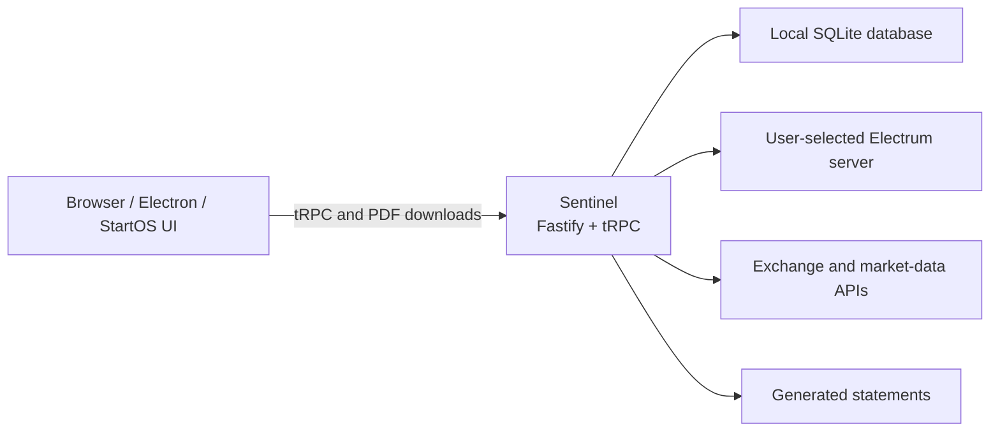

# Bitcoin Control Center

Bitcoin Control Center is a local-first Bitcoin savings app. Our mission is to help you **understand, grow, protect, and eventually use your Bitcoin savings**.

Today, it brings together portfolio tracking and proof-of-reserves statements. It connects directly to an Electrum server, stores portfolio data in a local SQLite database, and runs without a Hoseki cloud account or hosted application backend.

The same React application and Sentinel backend can run in a browser during development, as a StartOS service, or as an Electron desktop application for macOS and Windows.

> [!IMPORTANT]
> Bitcoin Control Center is watch-only portfolio software. Keep wallet seeds and private keys out of the application, logs, screenshots, bug reports, and test fixtures.

## Features

- Track self-custody Bitcoin accounts using descriptors and extended public keys.
- Connect supported hardware wallets, including Ledger, Trezor, Coldcard, and Keystone workflows.
- Track supported exchange accounts: Coinbase, Kraken, Robinhood, and Strike.
- Add manually maintained Bitcoin and ETF holdings.
- Record local balance history for portfolio charts.
- Prove control of self-custody accounts with signed-message challenges.
- Generate downloadable portfolio and proof-of-reserves statements.
- Store account data and encrypted exchange credentials locally.
- Package the same application for StartOS, macOS, and Windows.

This repository intentionally excludes Hoseki Services, Armadillo, hosted authentication, billing, sharing, telemetry, and cloud deployment code.

## Contents

- [Architecture](#architecture)
- [Prerequisites](#prerequisites)
- [Quick start](#quick-start)
- [Configure Sentinel](#configure-sentinel)
- [Run the application](#run-the-application)
- [Local data and backups](#local-data-and-backups)
- [Development commands](#development-commands)
- [Testing and CI](#testing-and-ci)
- [Production builds](#production-builds)
- [StartOS packaging](#startos-packaging)
- [Releases](#releases)
- [Desktop packaging](#desktop-packaging)
- [Troubleshooting](#troubleshooting)
- [Security and privacy](#security-and-privacy)
- [Contributing](#contributing)
- [License](#license)

## Architecture



| Path                   | Purpose                                                        |
| ---------------------- | -------------------------------------------------------------- |
| `apps/control-center/` | React 19 and Vite frontend                                     |
| `apps/api-sentinel/`   | Fastify/tRPC backend, SQLite storage, and statement generation |
| `packages/`            | Shared Bitcoin, wallet, UI, parsing, and utility code          |
| `start9/`              | StartOS SDK integration and multi-architecture package build   |
| `desktop/`             | Electron shell and bundled Tor integration                     |
| `docs/`                | Developer, security-audit, migration, and test documentation   |
| `test/`                | Shared public test fixtures                                    |

Sentinel is the only application backend and owns the frontend API contract. Distribution-specific behavior belongs in `start9/` or `desktop/`; the product does not use a hosted compatibility API.

## Prerequisites

Local browser development requires:

- Git
- Node.js 22.23.2 or newer; `.nvmrc` selects Node 22.23.2
- Corepack and pnpm 10.17.0
- Access to an Electrum server whose network matches `BITCOIN_NETWORK`
- A Chromium-based browser for WebHID hardware-wallet workflows

Optional packaging requirements are listed under [StartOS packaging](#startos-packaging) and [Desktop packaging](#desktop-packaging).

If you use `nvm`, install and select the repository's Node version with:

```bash
nvm install
nvm use
```

Confirm the active tools before installing dependencies:

```bash
node --version
corepack enable
pnpm --version
```

The root `package.json` pins pnpm through its `packageManager` field, so Corepack should select pnpm 10.17.0 automatically.

## Quick start

Clone the repository and enter its directory:

```bash
git clone https://github.com/hoseki-inc/bitcoin-control-center.git
cd bitcoin-control-center
```

Install the exact dependency graph from `pnpm-lock.yaml`:

```bash
nvm use
corepack enable
pnpm install --frozen-lockfile
```

Create Sentinel's local environment file:

```bash
cp apps/api-sentinel/.env.example apps/api-sentinel/.env
```

Edit `apps/api-sentinel/.env` and point it at your Electrum server. The checked-in example expects an unencrypted Electrum server on `127.0.0.1:50001`:

```dotenv
HOST=localhost
PORT=3400

ELECTRUM_HOST=127.0.0.1
ELECTRUM_PORT=50001
ELECTRUM_PROTOCOL=tcp

BITCOIN_NETWORK=mainnet
DATA_DIR=./data
LOG_LEVEL=info
```

Start the frontend and backend together:

```bash
pnpm dev
```

Open [http://localhost:4269](http://localhost:4269). Sentinel's health endpoint is available at [http://localhost:3400/health](http://localhost:3400/health).

Press `Ctrl+C` in the terminal to stop both processes.

## Configure Sentinel

Sentinel reads `apps/api-sentinel/.env` during local development. That file is ignored by Git.

| Variable                 | Required | Default                   | Description                                                                   |
| ------------------------ | -------- | ------------------------- | ----------------------------------------------------------------------------- |
| `ELECTRUM_HOST`          | Yes      | None                      | Electrum hostname or IP address                                               |
| `ELECTRUM_PORT`          | No       | `50001`                   | Electrum TCP or SSL port                                                      |
| `ELECTRUM_PROTOCOL`      | No       | `tcp`                     | `tcp` or `ssl`                                                                |
| `BITCOIN_NETWORK`        | No       | `mainnet`                 | `mainnet` or `testnet`; must match the Electrum server                        |
| `HOST`                   | No       | `localhost`               | Address on which Sentinel listens                                             |
| `PORT`                   | No       | `3400`                    | Sentinel HTTP port                                                            |
| `DATA_DIR`               | No       | `./data`                  | SQLite database and local secret-key directory                                |
| `LOG_LEVEL`              | No       | `info`                    | `trace`, `debug`, `info`, `warn`, `error`, or `fatal`                         |
| `MEMPOOL_API_URL`        | No       | `https://mempool.space`   | Base URL for market and transaction data; may point to a self-hosted instance |
| `APP_DIR`                | No       | Current working directory | Directory containing bundled `public/` and `assets/` folders                  |
| `SENTINEL_ALLOWED_HOSTS` | No       | Loopback hosts            | Comma-separated additional hostnames accepted by the protected local API      |
| `SOCKS_PROXY_HOST`       | No       | None                      | SOCKS proxy host; normally managed by the desktop package                     |
| `SOCKS_PROXY_PORT`       | No       | None                      | SOCKS proxy port; normally managed by the desktop package                     |

### Electrum connection guidance

- Prefer your own Electrum server for privacy and reliability.
- Plain `tcp` is appropriate for a loopback server or a network you trust. It is not encrypted.
- Remote Electrum servers commonly expose SSL on port `50002`, but confirm the server's actual configuration.
- A mainnet application must use a mainnet Electrum server; the same rule applies to testnet.
- An Electrum operator can observe the addresses or script hashes queried by the application. Treat a third-party server as a privacy tradeoff.

Example remote SSL configuration:

```dotenv
ELECTRUM_HOST=electrum.example.com
ELECTRUM_PORT=50002
ELECTRUM_PROTOCOL=ssl
BITCOIN_NETWORK=mainnet
```

### Binding beyond localhost

Sentinel has no user-login layer because it is designed for loopback or same-origin distribution use. Do not casually set `HOST=0.0.0.0` or expose port `3400` to an untrusted network.

`SENTINEL_ALLOWED_HOSTS` expands host and origin validation for a trusted reverse proxy or packaged environment. It is not authentication. StartOS supplies its own allowed local and onion hostnames during packaging.

## Run the application

The recommended root command is:

```bash
pnpm dev
```

It invokes Turbo with both required workspace packages:

```bash
pnpm turbo run dev:standalone --filter=api-sentinel --filter=control-center
```

The normal development endpoints are:

| Service               | URL                            |
| --------------------- | ------------------------------ |
| Control Center        | `http://localhost:4269`        |
| Sentinel health check | `http://localhost:3400/health` |
| Sentinel tRPC API     | `http://localhost:3400/trpc`   |

Vite may select the next free port if `4269` is already occupied. The development Sentinel will stop with an address-in-use error if `3400` is occupied. The desktop app reuses its previous loopback port when free and otherwise binds another, so it can run alongside development; its UI and wallet permissions use that actual address.

### Run the services separately

Use two terminals when you want to inspect logs independently.

Terminal 1 — Sentinel:

```bash
pnpm --filter api-sentinel dev
```

Terminal 2 — Control Center:

```bash
pnpm --filter control-center dev
```

### Preview desktop-only settings in a browser

From the repository root, start Sentinel and the live-reloading frontend in desktop mode together:

```bash
corepack pnpm dev:desktop
```

Open `http://localhost:4269` (stop any running `pnpm dev` first). This uses Sentinel's development data and exposes the desktop-only settings, including saved connections, without building an installer. Electron-managed Tor, native wallet integration, and OS certificate trust still require the packaged app.

### Saved desktop connections

Desktop Settings stores up to five Electrum connections with nicknames in Sentinel's SQLite database. The existing connection becomes **Current connection** on the first launch after upgrading. **Test Connection** probes a server without saving it; **Connect** or **Save & Reconnect** activates a profile only after a successful connection, and a failed switch keeps the previous active connection. Creating, renaming, and deleting profiles never contacts a server, and deleting keeps your accounts and wallet data. The active connection cannot be deleted.

Saved connections take precedence over the `.env` Electrum defaults, so editing `ELECTRUM_HOST` alone will not replace one. Onion addresses require Tor, which routes Electrum traffic only. StartOS does not enable saved connections.

## Local data and backups

With the example configuration, local state is written under `apps/api-sentinel/data/`:

- `sentinel.db` contains account configuration, balances, history, settings, and statement metadata.
- `secrets/exchange-credentials.key` encrypts locally stored exchange credentials.
- SQLite may create `sentinel.db-wal` and `sentinel.db-shm` while Sentinel is running.

The development data directory is ignored by Git. Packaged desktop keeps a separate `data/` directory under Electron's `userData` location: normally `~/Library/Application Support/Bitcoin Control Center/data/` on macOS and `%APPDATA%\Bitcoin Control Center\data\` on Windows. StartOS stores the equivalent state in its `main` volume at `/data`. The changing desktop HTTP port does not change this storage location.

Never commit these directories, upload them to an issue, or include them in a diagnostic archive.

Back up the complete data directory while Sentinel is stopped; fully quit the desktop app for a desktop backup. The database and encryption key must be preserved together; restoring only the database can make saved exchange credentials unreadable. Desktop does not yet provide a backup/restore UI.

To start with a fresh local profile without immediately deleting the old one, stop Sentinel and move the directory aside:

```bash
mv apps/api-sentinel/data apps/api-sentinel/data.backup
```

The next startup creates a new database and key. Restore the backup only while Sentinel is stopped.

Database migrations run automatically during startup. There is no separate local migration command.

## Development commands

Run these commands from the repository root unless noted otherwise.

| Command                     | Purpose                                                                                                  |
| --------------------------- | -------------------------------------------------------------------------------------------------------- |
| `pnpm dev`                  | Run Sentinel and Control Center in watch mode                                                            |
| `corepack pnpm dev:desktop` | Run both services with desktop settings in a browser preview                                             |
| `pnpm check`                | Run TypeScript project-reference checks                                                                  |
| `pnpm test`                 | Run application, shared-library, desktop, and release-assembly tests                                     |
| `pnpm lint`                 | Run ESLint with zero warnings allowed                                                                    |
| `pnpm format:check`         | Verify Prettier formatting                                                                               |
| `pnpm format`               | Apply Prettier formatting                                                                                |
| `pnpm build`                | Build Sentinel and the production web application                                                        |
| `pnpm security:audit`       | Audit root, desktop, and StartOS dependency graphs                                                       |
| `pnpm run ci`               | Run repository audits, formatting, lint, types, tests, and application builds; installers run separately |
| `pnpm ladle:serve`          | Run the shared component-workbench development server                                                    |
| `pnpm ladle:build`          | Build the component workbench                                                                            |

Focused workflows:

```bash
# Sentinel tests only
pnpm --filter api-sentinel test

# Control Center tests only
pnpm --filter control-center test

# Control Center tests in watch mode
pnpm --filter control-center test:watch

# Build one application
pnpm --filter api-sentinel build
pnpm --filter control-center build
```

## Testing and CI

Before opening a pull request, run:

```bash
pnpm format:check
pnpm lint
pnpm check
pnpm test
pnpm build
```

Run the dependency audit before releases and dependency changes:

```bash
pnpm security:audit
```

The default `pnpm test` command requires only the root workspace dependencies.
GitHub Actions additionally installs and type-checks the standalone packaging
workspaces and runs the StartOS tests:

```bash
npm ci --prefix desktop --ignore-scripts
npm ci --prefix start9 --ignore-scripts
npm ci --prefix start9/runtime --ignore-scripts
npm --prefix desktop run check
npm --prefix start9 run check
npm --prefix start9 test
```

The complete `pnpm run ci` command also runs packaging type checks and StartOS tests, and requires those packaging dependencies to be installed first. Candidate and draft-release workflows use this complete verification command. Native desktop installer builds and Electron runtime checks are additional GitHub jobs; the local `ci` command does not build installers.

Tests that open temporary localhost listeners may require normal host networking in restricted container or agent environments.

## Production builds

Build all root workspace targets with:

```bash
pnpm build
```

Or build each application explicitly:

```bash
pnpm --filter api-sentinel build
pnpm --filter control-center build
```

Build output is written to:

- `apps/api-sentinel/dist/` — bundled Node.js entry points and source maps
- `apps/control-center/dist/` — static production web application

The browser production build uses same-origin `/trpc` URLs and is intended to be served by the bundled Sentinel backend in a distribution package.

## StartOS packaging

The StartOS package uses the same Sentinel and Control Center builds. Packaging requires:

- Node.js, pnpm, and npm
- Docker with Buildx and support for multi-architecture builds
- The StartOS `start-cli`
- `make`, `git`, and `jq`

Follow the StartOS SDK installation documentation for your platform and make sure `start-cli`, Docker, and Buildx work before building.

Build without changing the package version:

```bash
./start9/build.sh
```

The script builds Sentinel and the same-origin web application, compiles the StartOS SDK code, creates x86_64 and aarch64 images, and packs `start9/hoseki-sentinel.s9pk`.

The checked-in graph under `start9/startos/versions/` supplies the shared release version. Use the [release workflows](#releases) to prepare version changes.

Inspect the current version without building:

```bash
node start9/scripts/version.mjs check
node start9/scripts/version.mjs get
node start9/scripts/version.mjs tag
```

> [!WARNING]
> The internal StartOS package ID is `hoseki-sentinel`, and its persistent volume is `main`. Existing installations rely on both identifiers. Do not rename them without an explicit data-migration and upgrade-compatibility plan.

See the [StartOS package reference](start9/README.md) for service configuration.

## Releases

GitHub Actions handles version preparation, builds, verification, checksums, and draft-release assembly:

| Workflow                                                                        | Result                                                                                                                       |
| ------------------------------------------------------------------------------- | ---------------------------------------------------------------------------------------------------------------------------- |
| [Release 1 - Prepare version](.github/workflows/prepare-startos-release.yml)    | Choose a release type; opens a version PR with a required release-notes placeholder.                                         |
| [Release 2 - Build candidates](.github/workflows/startos-candidate.yml)         | Builds StartOS, Mac ARM64, and Windows x64 test packages from one commit; retains Actions artifacts for 14 days.             |
| [Release 3 - Create draft release](.github/workflows/startos-draft-release.yml) | Verifies and builds all three platforms, then creates a draft GitHub Release with installers, build metadata, and checksums. |

Version preparation and draft creation run from the default branch. Replace the generated release notes before merging the version PR, and review the draft before publishing. Nothing publishes to a StartOS registry. Without the `STARTOS_DEV_KEY` secret, StartOS packages are signed with a temporary key suitable only for clean-install testing.

## Desktop packaging

The Electron 44 desktop runtime requires macOS 13 (Ventura) or later. The pinned Tor bundles target Apple Silicon macOS and Windows x64; cross-built installers still require testing on their target systems.

The desktop package embeds Sentinel, the web application, and pinned Tor binaries. The complete build requires:

- Node.js, pnpm, and npm
- Network access to download the pinned Tor expert bundles on the first build
- `curl`, `tar`, and either `shasum` or `sha256sum`
- The native build and signing prerequisites required by Electron Builder for your host platform

Build for the current native platform (Apple Silicon macOS or Windows x64 with Git Bash):

```bash
./desktop/build.sh
```

Use `./desktop/build.sh --mac` or `./desktop/build.sh --win` to select a target. On macOS, `./desktop/build.sh --all` also cross-builds Windows. Intel Mac packages are not supported by the bundled ARM64 Tor distribution.

The build script:

1. Downloads pinned macOS and Windows Tor artifacts when absent.
2. Verifies downloaded archives against pinned SHA-256 hashes before extraction; existing bundles are reused on later builds.
3. Builds Sentinel and the desktop-mode frontend.
4. Installs Electron's isolated npm dependencies.
5. Validates that the host can load the bundled `better-sqlite3` native prebuild.
6. Packages installers and stages them with build metadata and checksums under `desktop/release/artifacts/mac/` and `desktop/release/artifacts/win/`.

Installers are named `Bitcoin-Control-Center-<release-tag>-<platform>-<arch>` and carry the shared release version and source commit in their metadata; the placeholder version in `desktop/package.json` is overridden, not edited. Builds from uncommitted changes are marked dirty, and CI rejects them.

The [desktop build workflow](.github/workflows/build-desktop.yml) builds both installers on pull requests and pushes to `main`, then smoke-tests the packaged runtime (SQLite, backend startup, frontend assets, saved connections, and the bundled Tor binary). It does not replace installing the DMG/EXE, exercising hardware wallets, or testing upgrades with real data.

These are review installers: macOS is ad-hoc signed without notarization, and Windows has no publisher signature. Developer ID/notarization, Windows signing, and automatic updates are separate release work.

Run the isolated dependency checks in Electron's bundled Node runtime with:

```bash
npm ci --prefix desktop --ignore-scripts
npm --prefix desktop run install:electron
npm --prefix desktop run test:runtime
```

The explicit Electron download verifies the checksum supplied by the locked package. The runtime check uses a temporary SQLite database and synthetic PDF content; it does not open a wallet or use application data. CI runs it on macOS ARM64 and Windows x64. Installer launch, Tor, hardware-wallet signing, and visual PDF checks remain required before a desktop release.

## Troubleshooting

### Node or pnpm version errors

The repository requires Node.js 22.23.2 or newer and pnpm 10.17.0.

```bash
nvm install
nvm use
corepack enable
pnpm --version
```

If native packages were installed under a different Node version, select the correct version and reinstall dependencies with `pnpm install --frozen-lockfile`.

### Missing `.env` or `ELECTRUM_HOST`

Sentinel requires `ELECTRUM_HOST`. Recreate the local file if necessary:

```bash
cp apps/api-sentinel/.env.example apps/api-sentinel/.env
```

Then edit the connection values before restarting `pnpm dev`.

### Electrum connection refused, timeout, or TLS failure

- Confirm that the host is reachable from the machine running Sentinel.
- Confirm the port and `tcp`/`ssl` protocol with the Electrum operator.
- Confirm that `BITCOIN_NETWORK` matches the server.
- If the server is local, verify that it is listening on the configured interface.
- If DNS or TLS fails only in a sandbox, retry from a normal host terminal.

The desktop launcher includes certificate authorities already trusted by macOS or Windows alongside its bundled public authorities. For a StartOS Electrum interface using **Root CA**, download that authority from your trusted StartOS dashboard and follow [StartOS's certificate installation instructions](https://docs.start9.com/start-os/0.4.0.x/trust-ca.html), then fully quit and reopen the desktop app. Public TLS connections still require a valid certificate matching the configured IP address or hostname. This desktop trust setup does not change StartOS or other node distributions. The app does not install or automatically trust certificates received from a server.

### Port already in use

Check the default ports on macOS or Linux:

```bash
lsof -nP -iTCP:3400 -sTCP:LISTEN
lsof -nP -iTCP:4269 -sTCP:LISTEN
```

Stop the conflicting process or change `PORT` in Sentinel's `.env`. If you change Sentinel's port, update `VITE_BACKEND_API_URL` and `VITE_BACKEND_BASE_URL` in `apps/control-center/.env.sentinel` for regular development or `.env.desktop` for desktop browser preview. Packaged desktop keeps its own port and falls back to a free one when it is taken.

### Hardware wallet is not detected

- Use a Chromium-based browser for WebHID connections.
- Allow the device permission prompt and unlock the wallet.
- Open the required Bitcoin application on the hardware wallet.
- Close other wallet software that may already hold the USB connection.
- Use `localhost` rather than an arbitrary insecure remote origin.
- Coldcard and Keystone flows may use files or QR codes instead of a direct USB session.

### Empty or incorrect balances

- Verify that the account descriptor, extended public key, and network are correct.
- Verify that the Electrum server is fully synchronized.
- Check Sentinel logs for discovery or connection errors without sharing sensitive descriptor data publicly.
- Allow the first address discovery pass to finish; larger accounts can take longer.

### Reset local development data

Stop Sentinel first, then move `apps/api-sentinel/data/` aside as described in [Local data and backups](#local-data-and-backups). Keep the backup until the new profile is confirmed working.

## Security and privacy

Bitcoin Control Center is local-first, but it still communicates with infrastructure selected or configured by the user:

- The Electrum server receives blockchain queries related to tracked accounts.
- Exchange integrations send requests to the selected exchange's API.
- Market and transaction data use `MEMPOOL_API_URL`, which defaults to the public mempool.space instance.
- Desktop and StartOS distributions may route supported connections through their packaged networking configuration.

Additional safeguards:

- Sentinel binds to `localhost` by default.
- Protected API routes validate hosts, origins, and cross-site browser requests.
- Exchange credentials are encrypted using a key stored alongside the local database.
- Local `.env`, database, key, build, and runtime files are ignored by Git.
- The project does not include implicit hosted authentication, billing, or telemetry.

Do not log wallet descriptors, exchange credentials, encryption keys, seed phrases, or full third-party API responses containing secrets.

See [SECURITY.md](SECURITY.md) for private vulnerability reporting, dependency checks, and Electrum TLS trust limitations.

## Contributing

Issues and pull requests are welcome. Keep changes within the product's local-first boundary:

- Put product and API behavior in `apps/api-sentinel/`.
- Put shared UI, wallet, and Bitcoin logic in `packages/` when Control Center uses it.
- Keep StartOS- and Electron-specific configuration in their distribution directories.
- Preserve local storage, auditability, and the absence of an implicit cloud dependency.
- Give exported TypeScript functions explicit return types.
- Prefer `Result` values for expected failures.
- Use `parse` or `parseUnknown` from `@hoseki/packages/result/lib/parse` instead of direct Zod `.parse()` or `.safeParse()` calls in new product code.
- Add tests for behavior changes and run the verification commands before submitting a PR.
- Include screenshots or videos for visible UI changes.
- Consider StartOS upgrade and persistent-data compatibility for schema or packaging changes.

Useful project documentation:

- [Release workflows](#releases)
- [Security policy](SECURITY.md)
- [StartOS package reference](start9/README.md)
- [Multisig device signing tests](docs/Multisig%20Keystore%20Device%20Signing%20Tests.md)

Dependency compatibility: React currently uses React 18 type definitions because Chakra UI 2 depends on the older global JSX model. Review that bridge when upgrading the UI system. Upgrade React Query and tRPC together when their compatibility requirements change.

## License

Bitcoin Control Center is available under the [Apache License 2.0](LICENSE).
Third-party dependencies and assets remain subject to their respective licenses.
